


<table>
<tr>
<td valign="top">

### Hey, I'm Karan Patel 👋
**Full-Stack Developer · Backend Engineer · AI Builder**

I turn ideas into practical software, reliable backend systems, and AI-powered products.

🐍 **Python · FastAPI · Django** &nbsp;|&nbsp; 🗄️ **SQL · MySQL · MongoDB · ClickHouse** 
🤖 **AI agents · LLM apps · Voice AI** &nbsp;|&nbsp; 🐳 **Docker · REST APIs · Full-stack** 
🚀 Prototypes → deployed products

**Philosophy:** learn deeply, build consistently, make every project better than the last.

</td>
<td width="260" align="center" valign="middle">

</td>
</tr>
</table>


       
      
   
       
       
       

💡 Click any icon to open its official documentation.


Chakra levels are a personal self-assessment, not a formal measure.

<a href="https://www.dndpurchase.com/">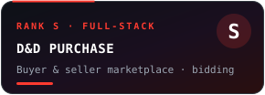</a>
<a href="https://ai-calling-agent-five.vercel.app/">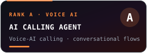</a>
<a href="https://aipm-one.vercel.app/">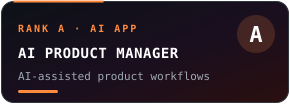</a>
<a href="https://pay-guard-ai-ten.vercel.app/">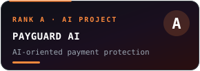</a>
<a href="https://dev-interviewer.lovable.app/">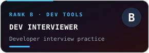</a>
<a href="https://rapid-code-insight.lovable.app/">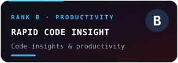</a>

Click a card to open the live project · <a href="https://github.com/KaranPatelDev/AI-Product-Manager">AI Product Manager source</a>

<b>🍃 More missions (C &amp; D rank)</b>

- **Twick**: Django-based web application
- **Gesture Control Software**: Python, OpenCV, MediaPipe, Flet, PyAutoGUI
- **Face Recognition Attendance**: computer-vision project


<table>
<tr>
<td width="33%" align="center"> <b>01 · TRAIN</b> Kakashi's discipline. Practice the fundamentals daily.</td>
<td width="33%" align="center"> <b>02 · THINK</b> Sasuke's Sharingan. Understand first, keep it simple.</td>
<td width="33%" align="center"> <b>03 · SHIP</b> Naruto's Sage Mode. Build useful things, iterate.</td>
</tr>
</table>

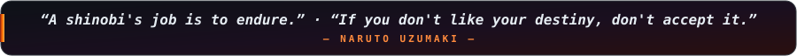

Thanks for visiting. See you on the next mission! 🍥

